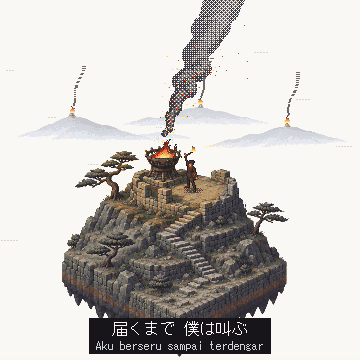
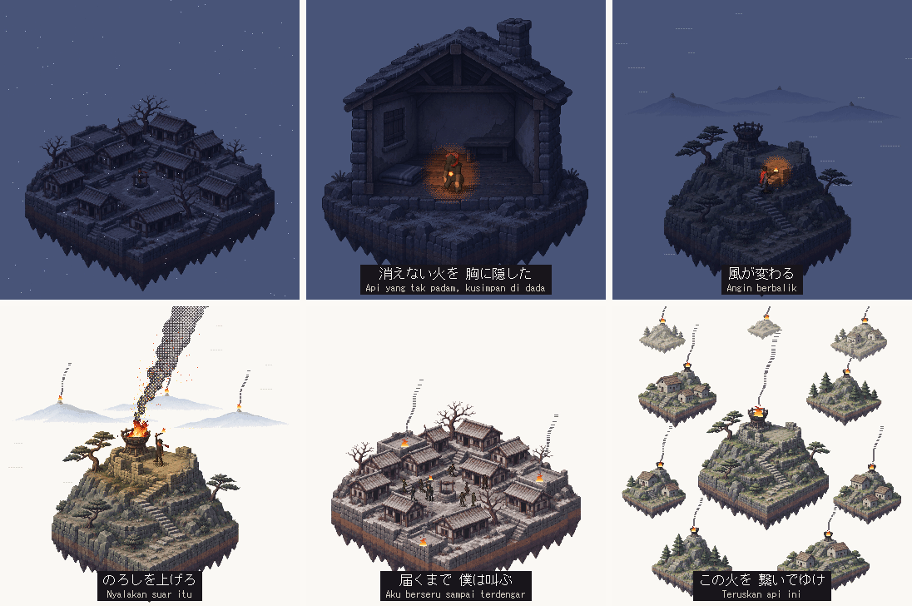
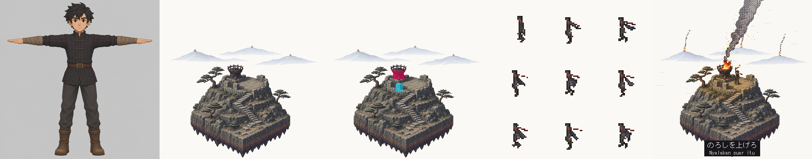
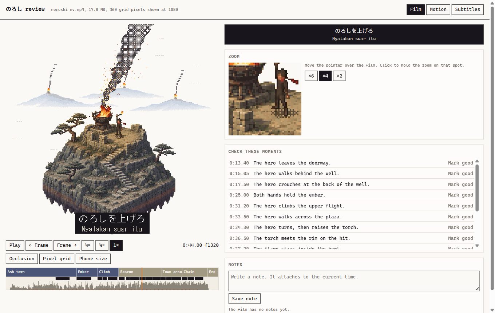
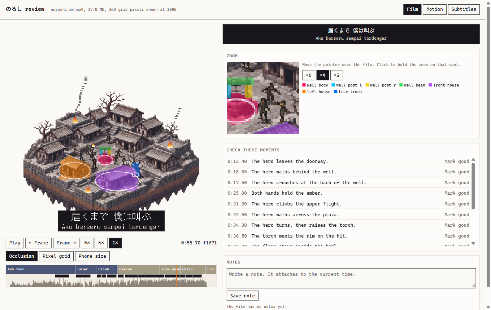
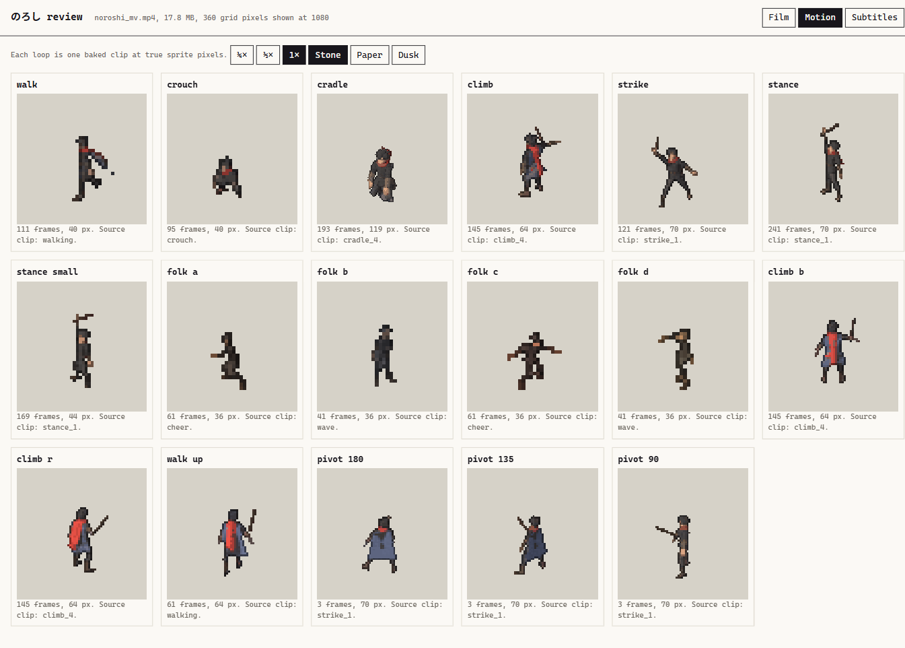
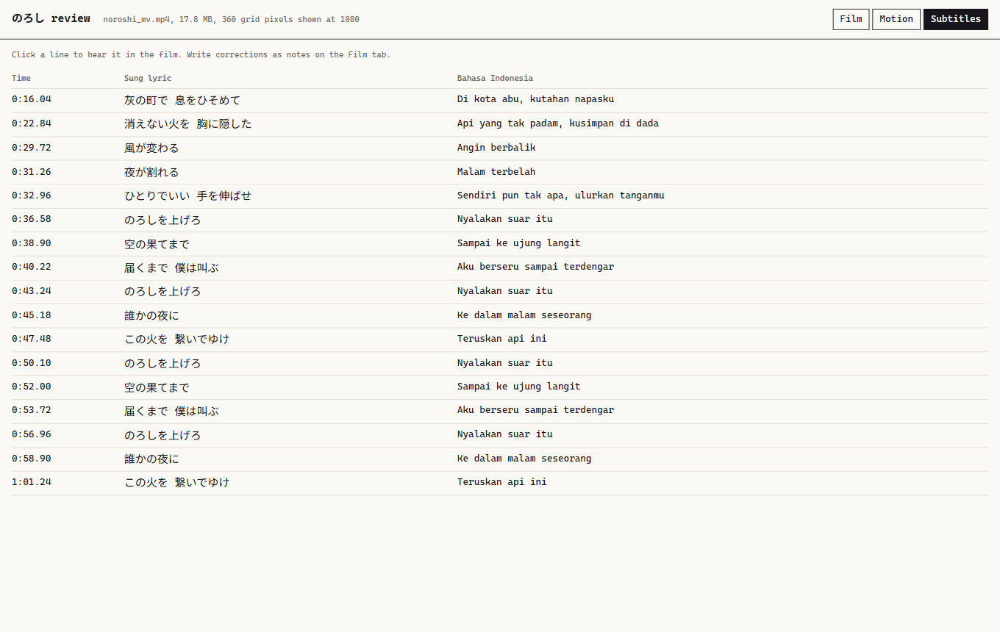

# Mini MV Studio

Mini MV Studio is a method and a toolkit for AI agents. It makes square pixel-art music videos for phones.

An agent writes the song, paints the world, rigs real 3D characters and bakes them into pixel sprites. It renders one mp4 with exact occlusion, natural motion and subtitles. A person judges the song and the film at two gates.

<p align="center"></p>

`mvs/noroshi/` is one complete film. Read it, then render it. The clip above has no sound. Render the film to hear the song.



## From concept to frame



From left to right, the panels show:

1. The character concept. Tripo turns the concept into a 3D model.
2. The plate. An image model paints the scenery.
3. The occluders. These masks put a person behind the scenery.
4. The baked sprites. Blender rigs the model, plays the motion clips and bakes the frames.
5. The final frame, with subtitles below the sung lyrics.

## Quick start

```bash
pip install -r requirements.txt
python tools/doctor.py
python tools/render.py mvs/noroshi --window 0,10
```

The render needs no API keys. Noroshi ships with its song, plates and baked sprites.

Set your handle in `studio.json`. The end card of each film shows the studio line, your handle and the year.

## Make your own film

1. Point your agent at this repo. `AGENTS.md` is the entry point. Claude Code also finds the `mini-mv-studio` skill.
2. Run `python tools/new_film.py my_film "My Film"`.
3. Follow `docs/PRODUCTION.md`, step by step.

The method stops twice for a person. You choose the song take by ear. You approve the film in the review canvas.

## What you need

| Need | Used for | Notes |
|---|---|---|
| Python 3.13 and `requirements.txt` | All tools | Python 3.11 or newer should work. The author tested 3.13 |
| ffmpeg and ffprobe | Audio and video | Must be on PATH |
| Blender 5.2 | Rig and bake | Set `BLENDER` if the program is not on PATH |
| CJK fonts | Captions and the end card | Set `FONT_DIR` if `doctor.py` finds none |
| `GEMINI_API_KEY` | Songs with Lyria | Paid service |
| `OPENAI_API_KEY` | Plates and concepts | Paid service |
| `FAL_KEY` | 3D characters with Tripo | Paid service |
| `ELEVENLABS_API_KEY` | Word timings with Scribe | Paid service |
| Motion clips | Natural movement | The PINOC connector, or any GLB with a Mixamo rig |

`.env.example` lists each key. The tools read keys from the environment and never store them.

## What is in this repo

| Path | Contents |
|---|---|
| `docs/PRODUCTION.md` | The complete method, with each trap that the studio has found |
| `docs/COPY.md` | The writing rules for docs and on-screen text |
| `tools/` | Song, plate, rig, bake, render and QA tools, and the review canvas |
| `templates/film/` | The starting point of a new film |
| `mvs/noroshi/` | One complete film, without its 3D model and motion clips |
| `examples/film_code/` | The film code of eleven more films, as patterns. Their assets are not here |

## Review a film

```bash
python tools/review_server.py 5350
```

Open http://127.0.0.1:5350/. Space plays the film. The arrow keys step 1 frame. O shows occlusion. N opens a note.

The canvas saves each note with its time in `mvs/<id>/review/notes.json`. Your agent reads this file and fixes the film.

### Film

The timeline shows scenes, lyrics and the waveform. The zoom lens shows each pixel. The list gives the moments to check.



### Occlusion

The overlay shows each occluder on the plate. Use it to find a person who stands in the wrong place.



### Motion

Each baked clip loops at true sprite pixels. You can slow a clip and change its background.



### Subtitles

The table shows each sung line with its translation. Click a line to hear it in the film.



## Status

The author develops this on Windows. The tools have portable paths, but the author has not tested them on macOS or Linux. Please report what you find.

## License

The code is under the MIT license. See `LICENSE`. The example film is under CC BY-NC 4.0. See `LICENSE-FILMS.md`. `NOTICE.md` covers third-party services and your own responsibilities.

@ashthepeasant created Mini MV Studio.
